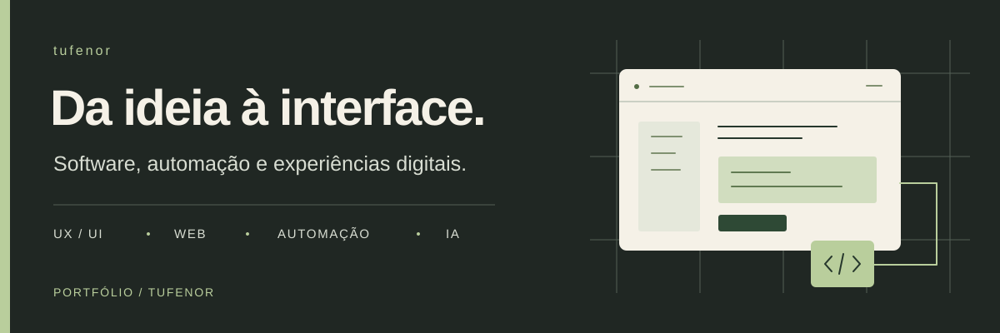
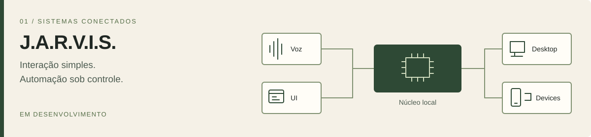
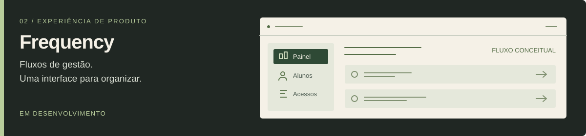
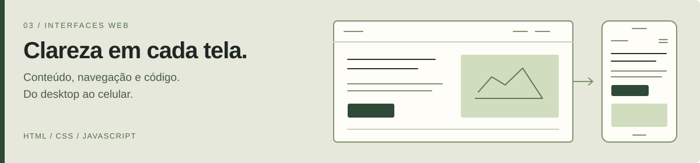

  

<h1 align="center">Gabriel de Moura Pereira</h1>

<em>Interfaces web, automação e ferramentas — do fluxo ao código.</em>

  <a href="#projetos">Projetos</a> ·
  <a href="#repositórios-públicos">Repositórios</a> ·
  <a href="#como-trabalho-com-ia">Como uso IA</a> ·
  <a href="#vamos-conversar">Contato</a>

---

Construo interfaces e sistemas que conectam **UX/UI, desenvolvimento web, automação e inteligência artificial**. Meu foco é transformar uma ideia em experiência clara: organizar o fluxo, desenhar a interface e implementar o que acontece por trás dela.

Trabalho principalmente com **HTML, CSS, JavaScript, React, Python e FastAPI**, e há algum tempo com **Kotlin/Compose** e **MicroPython** nos projetos de automação. Gosto de escopo pequeno, critério de aceite objetivo e código que outra pessoa consegue ler depois.

> Este perfil é um retrato honesto do que existe hoje. Projetos privados aparecem descritos, não publicados; estudos aparecem como estudos. Não há métricas de conversão, depoimentos ou clientes inventados.

## Como sugerir código

Você pode propor uma melhoria de conteúdo, acessibilidade ou código abrindo uma [issue de melhoria](../../issues/new?template=feature_request.yml). A ideia deve apontar o arquivo ou seção afetada e explicar como validar o resultado.

## Projetos

### J.A.R.V.I.S. — assistente pessoal para Windows

Assistente pessoal em desenvolvimento, com foco em **processamento local**, voz em português e automação controlada do computador. O sistema conecta uma interface de controle, ferramentas do próprio PC, um microcontrolador **ESP32** e um aplicativo companion em **Android**.

| | |
|---|---|
| **Meu trabalho** | Experiência de interação, painel de controle, integrações e diagnóstico |
| **Tecnologias** | Python, FastAPI, Kotlin/Compose, MicroPython |
| **Código** | [tufenor/jarvis](https://github.com/tufenor/jarvis) — núcleo, firmware e app Android |
| **Estágio** | Em desenvolvimento; configuração e credenciais ficam fora do repositório |

O aprendizado que carrego dele: automação de verdade precisa de **limites explícitos**, confirmação antes de ações destrutivas e logs que expliquem o que falhou.

### Frequency — gestão de academia

Sistema de gestão de academia em desenvolvimento, com **API FastAPI**, **PostgreSQL** e interface web em português. Os fluxos cobertos são os de alunos, presenças, planos e administração.

| | |
|---|---|
| **Meu trabalho** | Modelagem de dados, fluxos de gestão e coerência entre telas e API |
| **Tecnologias** | Python, FastAPI, PostgreSQL, HTML/CSS/JavaScript |
| **Código** | [tufenor/frequency](https://github.com/tufenor/frequency) — API, frontend e manual do cliente |
| **Estágio** | Em desenvolvimento; dados de academia e backups ficam fora do repositório |
| **Foco de produto** | Tornar tarefas administrativas compreensíveis na interface, não só funcionais |

Cada funcionalidade tem seu próprio estágio de validação — a apresentação aqui descreve o projeto em construção, não um produto lançado.

### Web — páginas, apresentação e experiência

Páginas estáticas e estudos de frontend. É onde testei composição, tipografia, responsividade e acessibilidade em projetos pequenos e verificáveis:

| Projeto | O que é | Código |
|---|---|---|
| **MYD-Site** | Site de apresentação para marketing digital, em HTML e CSS | [tufenor/MYD-Site](https://github.com/tufenor/MYD-Site) |
| **Site-Apresentacao** | Site de apresentação com foco mobile, em HTML, CSS e JavaScript | [tufenor/Site-Apresentacao](https://github.com/tufenor/Site-Apresentacao) |
| **Alura-Plus** | Estudo de frontend | [tufenor/Alura-Plus](https://github.com/tufenor/Alura-Plus) |

As ilustrações desta página são **diagramas conceituais**, não capturas das interfaces dos produtos.

Também publiquei um **case do processo**: como montei uma operação de prospecção e entrega com agentes de IA, o que funcionou, o que falhou e o que deliberadamente não automatizei. [Ler o case](https://tufenor.github.io/portfolio/projeto/).

## Repositórios públicos

| Repositório | Linguagem | O que você encontra |
|---|---|---|
| [MYD-Site](https://github.com/tufenor/MYD-Site) | HTML | Site de apresentação para marketing digital |
| [Site-Apresentacao](https://github.com/tufenor/Site-Apresentacao) | JavaScript | Site de apresentação com foco mobile |
| [Alura-Plus](https://github.com/tufenor/Alura-Plus) | HTML | Estudo de frontend |
| [Exercicios-de-treino-js](https://github.com/tufenor/Exercicios-de-treino-js) | HTML | Exercícios de prática em JavaScript |
| [jarvis](https://github.com/tufenor/jarvis) | Python | Núcleo do assistente, firmware ESP32 e app Android |
| [frequency](https://github.com/tufenor/frequency) | Python | Gestão de academia: API FastAPI, frontend React e manual |
| [portfolio](https://github.com/tufenor/portfolio) | HTML | Vitrine e demonstração de correção de responsividade |
| [openclaw-server](https://github.com/tufenor/openclaw-server) | — | Repositório de experimentação; README mínimo |
| [rea](https://github.com/tufenor/rea) | — | Exploração de engenharia reversa com agentes. O projeto original é [REA, de morluto](https://github.com/morluto/rea); consulte a documentação e a autoria de lá |

Os dois projetos têm repositório público com o código-fonte. O que fica de fora é o que não pode ser público: banco de dados, backups, credenciais, configuração de máquina e dados de academia.

## Como trabalho com IA

Uso IA na pesquisa e na implementação, com revisão do resultado. Na prática isso significa:

- leio e testo o que a ferramenta gera, em vez de aceitar a saída como entrega;
- declaro o uso de IA quando o cliente ou a plataforma exige;
- não invento experiência, autoria, depoimento ou resultado de negócio;
- não publico código privado, dados de cliente ou credenciais para "provar" capacidade.

Isso não é modéstia: é o que permite assumir responsabilidade técnica pelo que está no ar.

## O que posso entregar

- **Correção mobile/UX** — uma página, até cinco defeitos acordados, antes/depois e verificação em larguras reais.
- **Landing page de uma oferta** — até seis seções, versão mobile, CTA e código documentado.
- **Automação pontual** — uma entrada, uma transformação e uma saída, com tratamento de falhas e guia de uso.
- **Diagnóstico de instalação** — reproduzir um defeito, corrigir o que está no código e entregar um checklist de instalação limpa.

Trabalho bem com **escopo fechado e critério de aceite escrito**. Projetos maiores entram depois, com marcos separados.

## Vamos conversar

Envie o objetivo do projeto, uma referência e o prazo desejado. A partir disso, organizamos uma primeira entrega com escopo definido.

[LinkedIn](https://linkedin.com/in/tufenor) · [Instagram](https://instagram.com/tufenor) · [TikTok](https://tiktok.com/@tufenor) · [GitHub](https://github.com/tufenor)

---

<strong>EN — short version</strong>

I build web interfaces and work on automation and AI projects. Most of my work is in HTML/CSS/JavaScript, React, Python and FastAPI, with Kotlin/Compose and MicroPython on the automation side.

I use AI for research and implementation, then review the output. I do not publish private code or client data to build a portfolio, and I do not claim clients, metrics or results that did not happen. The private projects (a Windows personal assistant and an academy management system) are described here, not open-sourced.

Open to small, clearly scoped projects with reviewable deliverables. Please share your goal, references and timeline.

<strong>ES — versión corta</strong>

Desarrollo interfaces web y trabajo en proyectos de automatización e IA. Mi stack principal es HTML/CSS/JavaScript, React, Python y FastAPI, con Kotlin/Compose y MicroPython en la parte de automatización.

Uso IA para investigación e implementación, y reviso el resultado. No publico código privado ni datos de clientes para armar el portfolio, y no invento clientes, métricas ni resultados. Los proyectos privados (un asistente personal para Windows y un sistema de gestión de gimnasio) están descritos, no publicados.

Disponible para proyectos pequeños, con alcance y criterios de aceptación claros. Comparte el objetivo, las referencias y el plazo.

